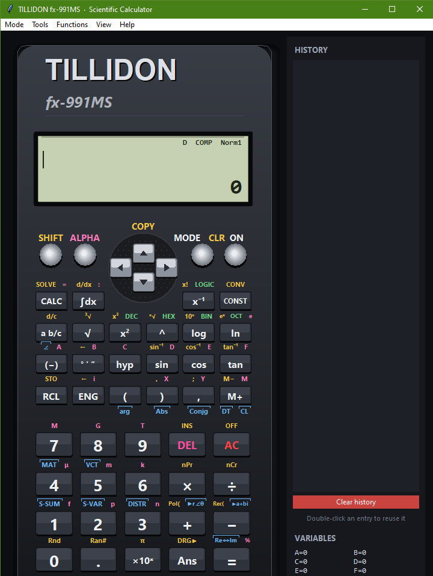

-brightgreen.svg)

# 🧮 TILLIDON fx-991MS — Scientific Calculator

***A lightweight, high-precision, and modern desktop scientific calculator built with a custom resizable Tkinter canvas interface traced directly from a physical fx-991MS. Designed with zero external dependencies and powered by Python.***

---

## ✨ Key Features

1. **Authentic Hardware Layout & Ergonomics:** Resizable vector-drawn Tkinter canvas interface (`F11` full-screen support) with dynamic `SHIFT`, `ALPHA`, and mode-aware key legends, plus 6 built-in themes (**Midnight**, **Graphite**, **Ocean**, **Rose Gold**, **Emerald**, **Sunset**).

2. **8 Comprehensive Calculation Modes:**
   * 🔢 **COMP & BASE-N:** Standard arithmetic, fractions (`a b/c`), DMS (`° ′ ″`), engineering prefixes, and signed 32-bit **DEC / HEX / BIN / OCT** bitwise logic (`AND`, `OR`, `XOR`, `XNOR`, `NOT`).
   * 📐 **CMPLX, EQN, MAT & VCT:** Complex numbers (`a+bi` & `r∠θ`), simultaneous linear solvers (2–3 unknowns), quadratic/cubic polynomial roots, and full matrix/vector algebra (`det`, `trn`, `inv`, `dot`, `cross`).
   * 📊 **SD & REG:** Single-variable statistics, 6 regression models (**Lin**, **Log**, **Exp**, **Pwr**, **Inv**, **Quad**), and normal distribution (`DISTR`) probability calculations.

3. **Numerical Calculus & Equation Solvers:** Built-in adaptive Simpson definite integration `∫(f(X), a, b)`, 5-point stencil differentiation `d/dx(f(X), a)`, multi-variable `CALC` evaluation, and Newton-Raphson `SOLVE` root finding.

4. **Interactive Graphing & Reference Tables:** Plot up to 3 functions of `X` simultaneously (drag to pan, scroll to zoom, live coordinate tracing, and value tables), alongside 40 CODATA scientific constants (`CONST`) and 20 unit conversions (`CONV`).

5. **Standalone Executable:** Fully compiled into a single, portable `.exe` file (`--onefile`) with integrated multi-resolution app icons—no Python installation required for end-users.

---

## 📁 Project Structure

```text
Tillidon-fx991ms/
├── assets/
│   ├── icon.ico
│   └── app_preview.png
├── dist/
│   └── Synapse991.exe             # Main Executable File
├── scientific_calculator.py       # Main Application Code
├── README.md                      # Project Documentation
└── LICENSE.md                     # Open-source License
```

---

## 🚀 Quick Start (For Developers / Python user)

1. **Clone the repository:**

```bash
git clone https://github.com/TILLIDON/Tillidon-fx991ms.git
cd Tillidon-fx991ms
```

2. **Run the application:**

```bash
python scientific_calculator.py
```

*(Note: No `pip install` is required—only Python's built-in standard library is used. On Linux, run `sudo apt install python3-tk` if Tkinter is not pre-installed.)*

---

## 🚀 Quick Start (For End-Users / Executable)

If Python is not installed on your system and you want to run the compiled application directly:

1. **Download the Executable:**
   * Go to the [Releases](../../releases) section of this repository.
   * Download the latest `Synapse991.exe` file.

2. **Run the Application:**
   * Double-click on `Synapse991.exe` to launch the graphical user interface.
   * Press **Help > Key guide** inside the app to view all keyboard shortcuts, modes, and syntax!

---

## 📸 Application Screenshot



---

## 📐 Mathematical Engine & Architecture

* **Parser & Evaluator:** Safe AST-based expression parser supporting implicit multiplication, chained statements (`:`), polar/rectangular notation (`r∠θ`), and live preview rendering.
* **Numerical Precision:** Double-precision IEEE 754 floating-point math with adaptive Simpson quadrature, Gaussian elimination with partial pivoting, and Durand-Kerner polynomial root approximation.
* **Persistent State:** Live sidebar for calculation history (double-click to recall) and variable registers (`A`–`F`, `X`, `Y`, `M`, `Ans`), with theme preferences saved locally in `~/.tillidon_fx991ms.json`.

---

## ⚠️ Disclaimer & License

Distributed under the **MIT License**. See [LICENSE.md](LICENSE.md) for more information.

> **Note:** TILLIDON fx-991MS is an independent open-source software project inspired by the classic fx-991MS layout and is not affiliated with or endorsed by Casio Computer Co., Ltd. Always verify critical engineering or academic calculations independently.